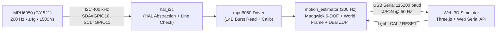

# ESP32-S3 MPU6050 — 6-DOF Motion Direction Simulator


Hệ thống thu thập dữ liệu IMU 6 trục (**MPU6050 / GY-521**) trên vi điều khiển **ESP32-S3 N16R8** (ESP-IDF v6.1) kết hợp thuật toán hợp nhất cảm biến **Madgwick 6-DOF** và trình mô phỏng **3D thời gian thực trên trình duyệt (Three.js + Web Serial API)** để xác định và trực quan hóa **chiều chuyển động** (`+X / -X`, `+Y / -Y`, `+Z / -Z`, `ROT`, `STATIC`) cùng tư thế góc xoay của thiết bị.

---

## Mục lục

- [Tính năng nổi bật](#-tính-năng-nổi-bật)
- [Kiến trúc hệ thống](#-kiến-trúc-hệ-thống)
- [Cấu trúc thư mục](#-cấu-trúc-thư-mục)
- [Phần cứng & Sơ đồ nối dây](#-phần-cứng--sơ-đồ-nối-dây)
- [Nguyên lý xử lý tín hiệu](#-nguyên-lý-xử-lý-tín-hiệu)
- [Giao thức Serial Telemetry](#-giao-thức-serial-telemetry)
- [Hướng dẫn cài đặt & chạy](#-hướng-dẫn-cài-đặt--chạy)
- [Kiểm thử thuật toán](#-kiểm-thử-thuật-toán)
- [Giới hạn vật lý & Lưu ý](#-giới-hạn-vật-lý--lưu-ý)
- [Giấy phép](#-giấy-phép)

---

## ✨ Tính năng nổi bật

- **Kiến trúc HAL tách lớp (`hal_i2c`):** Tách biệt hoàn toàn lớp trừu tượng phần cứng (`components/hal_i2c`) khỏi driver cảm biến (`components/mpu6050`), cấu hình tập trung tại `hal_i2c_config.h` và hỗ trợ `idf.py menuconfig`.
- **Chẩn đoán bus I2C tự động:** Tự kiểm tra mức logic nhàn rỗi (`SDA`/`SCL`), tự dò địa chỉ `0x68` ↔ `0x69` theo chân `AD0`, và phát hiện tình trạng đấu ngược dây `SDA ↔ SCL`.
- **Hợp nhất cảm biến 6-DOF @ 200 Hz:** Bộ lọc **Madgwick AHRS** tính **Quaternion** thời gian thực không bị khóa khớp (gimbal lock), xoay gia tốc từ hệ tọa độ cảm biến sang **hệ tọa độ thế giới (World Frame)** để loại bỏ trọng lực $1g$ ngay cả khi cầm nghiêng bo mạch.
- **Dual ZUPT chống trôi:** Kết hợp kiểm tra đồng thời ngưỡng tĩnh của cả Gia tốc tuyến tính và Gyroscope giúp triệt tiêu sai số trôi vận tốc khi thiết bị dừng.
- **Trình mô phỏng 3D không cần cài app (`web_sim/`):** Chạy trực tiếp trên Chrome/Edge qua **Web Serial API**, hiển thị mô hình bo mạch 3D, mũi tên vector hướng chuyển động, vệt quỹ đạo, đồ thị gia tốc 3 trục thời gian thực và **Chế độ Giả lập (Mock Mode)** để kiểm thử giao diện ngay cả khi chưa cắm mạch.

---

## 🏗 Kiến trúc hệ thống



---

## 📂 Cấu trúc thư mục

```text
ESP32-S3/
├── CMakeLists.txt
├── sdkconfig.defaults                # Target esp32s3, 16MB Flash, 8MB Octal PSRAM, 1000Hz Tick
├── components/
│   ├── hal_i2c/                      # Lớp trừu tượng phần cứng (HAL) cho I2C & GPIO
│   │   ├── include/hal_i2c_config.h  # Cấu hình chân mặc định (SDA=10, SCL=11, 400kHz)
│   │   ├── include/hal_i2c.h
│   │   └── hal_i2c.c
│   ├── mpu6050/                      # Driver MPU6050 độc lập phần cứng (gọi qua hal_i2c)
│   │   ├── include/mpu6050.h
│   │   └── mpu6050.c
│   └── motion_estimator/             # Thuật toán C thuần: Madgwick 6-DOF, World Frame, Dual ZUPT
│       ├── include/motion_estimator.h
│       └── motion_estimator.c
├── main/
│   ├── Kconfig.projbuild             # Menu cấu hình chân I2C & địa chỉ MPU6050
│   └── main.c                        # Task lấy mẫu 200Hz, stream 50Hz & xử lý lệnh CAL/RESET
├── tests/
│   ├── test_motion_estimator.c       # Unit test C cho motion_estimator
│   └── verify_motion_math.py         # Script Python kiểm chứng toán học 6-DOF & ZUPT
└── web_sim/                          # Giao diện mô phỏng 3D (Three.js + Web Serial API)
    ├── index.html
    ├── style.css
    └── app.js
```

---

## 🔌 Phần cứng & Sơ đồ nối dây

### Yêu cầu linh kiện
- **ESP32-S3 DevKitC-1 N16R8** (16MB Flash, 8MB Octal PSRAM)
- **Module MPU6050 (GY-521)**
- Dây cắm test (khuyên dùng hàn chắc header lên GY-521 để tránh tiếp xúc I2C chập chờn)

### Bảng nối chân (I2C)

| Chân MPU6050 (GY-521) | Chân ESP32-S3 N16R8 | Ghi chú |
| :--- | :--- | :--- |
| **VCC** | **3V3** | Cấp nguồn `3.3V` ổn định |
| **GND** | **GND** | Nối đất chung |
| **SDA** | **GPIO 10** | Dữ liệu I2C (an toàn với Octal PSRAM) |
| **SCL** | **GPIO 11** | Xung nhịp I2C (`400 kHz`) |
| **AD0** *(hoặc `ADO`)* | **GND** | Địa chỉ I2C `0x68` (nếu nối `3V3` là `0x69`) |
| **XDA / XCL / INT** | *(Bỏ trống)* | Không sử dụng |

> [!IMPORTANT]
> **Lưu ý quan trọng đối với board ESP32-S3 N16R8:**
> 1. **Tuyệt đối không dùng `GPIO26–GPIO37`** (đặc biệt `GPIO33–37` dành cho bộ nhớ Octal PSRAM/Flash nội bộ).
> 2. **Cấp nguồn cho MPU6050 từ chân `3V3`, không lấy từ `5Vin`:** Trên nhiều board ESP32-S3 N16R8 có diode chống ngược ở chân `5Vin`, nên khi chỉ cắm cáp USB chân `5Vin` không cấp ra 5V (chỉ có áp rò ~0.5V), khiến điện trở kéo lên trên GY-521 kéo sụt cả `SDA` & `SCL` về mức thấp.
> 3. **Chọn cổng USB:** Board có 2 cổng Type-C; cắm vào **cổng UART (bên phải, dưới chip cầu nối USB-UART)** để nạp code tự động và gửi/nhận lệnh Serial ổn định nhất.

---

## 🧮 Nguyên lý xử lý tín hiệu

1. **Hiệu chuẩn tĩnh (Stationary Calibration):** Khi khởi động (hoặc khi nhận lệnh `CAL`), thiết bị lấy trung bình 300 mẫu trong ~1.5 giây để bù offset cho cả 3 trục Gyroscope (`°/s`) và 3 trục Accelerometer (`g`, giữ lại `+1g` trên trục Z).
2. **Ước lượng tư thế (Madgwick 6-DOF):** Kết hợp vận tốc góc và vector trọng lực ở 200 Hz ($\Delta t = 5\text{ ms}$) để cập nhật Quaternion $q = (q_w, q_x, q_y, q_z)$.
3. **Loại bỏ trọng lực theo World Frame:**
   $$\vec{a}_{\text{lin}} = \mathbf{R}(q)\,\vec{a}_{\text{body}} - (0,\ 0,\ 1g)^T$$
   Nhờ vậy, dù người dùng xoay hay nghiêng bo mạch, gia tốc thẳng đứng $1g$ của Trái Đất vẫn được triệt tiêu đúng phương.
4. **Dual ZUPT & Phân loại hướng:**
   - Khi $|\vec{a}_{\text{lin}}| < 0.045g$ và $|\vec{\omega}| < 3.0\ ^\circ/\text{s}$ liên tục trong 16 mẫu (80 ms), vận tốc được đưa về `0` và vị trí mô phỏng hồi dần về tâm.
   - Hướng chuyển động (`+X/-X`, `+Y/-Y`, `+Z/-Z`, `ROT`, `STATIC`) được suy ra từ trục vận tốc/gia tốc chiếm ưu thế theo hệ tọa độ thế giới.

---

## 📡 Giao thức Serial Telemetry

- **Tốc độ Baud:** `115200` (8N1)
- **Tần suất xuất dữ liệu:** `50 Hz` (1 dòng JSON mỗi 20 ms)

**Mẫu gói tin Telemetry:**
```json
{"t":57304,"qw":0.998,"qx":0.000,"qy":-0.029,"qz":-0.062,"ax":0.00,"ay":0.01,"az":-0.06,"vx":0.00,"vy":0.00,"vz":0.00,"px":0.000,"py":0.000,"pz":0.000,"roll":0.2,"pitch":-3.3,"yaw":-7.1,"dir":"STATIC"}
```

**Lệnh điều khiển gửi xuống ESP32-S3 (kết thúc bằng `\n`):**
| Lệnh | Chức năng | Phản hồi |
| :--- | :--- | :--- |
| `CAL` | Hiệu chuẩn lại bias Gyro + Accel (đặt thiết bị nằm phẳng yên ~1.5s) | `{"evt":"calibrated"}` |
| `RESET` | Đặt lại góc `Yaw = 0` và tọa độ mô phỏng `(0, 0, 0)` (giữ nguyên Roll/Pitch) | `{"evt":"reset"}` |

---

## 🚀 Hướng dẫn cài đặt & chạy

### 1. Biên dịch và nạp Firmware (ESP-IDF v6.1)

```powershell
# Kích hoạt môi trường ESP-IDF v6.1
. "C:\Espressif\tools\Microsoft.v6.1.PowerShell_profile.ps1"
cd d:\ESP32-S3

# Thiết lập target (nếu build lần đầu) và biên dịch
idf.py set-target esp32s3
idf.py build

# Nạp firmware và kiểm tra log (thay COM42 bằng cổng COM thực tế)
idf.py -p COM42 flash monitor
```

> Đặt bo mạch nằm phẳng, giữ yên ~1.5 giây đầu sau khi boot để hoàn tất hiệu chuẩn ban đầu. Nhấn **`Ctrl + ]`** để thoát `idf_monitor` trước khi kết nối từ trình duyệt.

*(Tuỳ chọn)* Đổi chân I2C khác: chạy `idf.py menuconfig` → **`ESP32-S3 MPU6050 Motion Configuration`** hoặc sửa trực tiếp tại [hal_i2c_config.h](file:///d:/ESP32-S3/components/hal_i2c/include/hal_i2c_config.h).

### 2. Khởi chạy Trình mô phỏng 3D (`web_sim/`)

Khởi động HTTP server nội bộ (Web Serial API yêu cầu chạy trên `http://localhost` hoặc HTTPS):

```powershell
python -m http.server 8765 --directory d:\ESP32-S3\web_sim
```

Mở **Google Chrome** hoặc **Microsoft Edge** tại địa chỉ **`http://localhost:8765/`**:
1. Bấm **`Kết nối USB Serial`** → chọn cổng COM của ESP32-S3 (`115200` baud).
2. Đặt board nằm yên trên bàn, bấm **`Calibrate (CAL)`**, sau đó bấm **`Zero Yaw / Reset`**.
3. Di chuyển thiết bị theo các hướng hoặc nghiêng/xoay để quan sát mô hình 3D, mũi tên vector và đồ thị gia tốc.
4. *(Tuỳ chọn)* Bấm **`Bật Giả lập (Mock)`** để thử các kịch bản chuyển động mẫu ngay cả khi không gắn phần cứng.

---

## 🧪 Kiểm thử thuật toán

Kiểm chứng bộ ước lượng `motion_estimator` độc lập trên máy tính (tĩnh, đẩy trục `+X` + hồi tâm ZUPT, và tịnh tiến `+Y` khi đang nghiêng `45°`):

```powershell
python tests\verify_motion_math.py
```

Kiểm tra biên dịch C unit test với cảnh báo nghiêm ngặt:

```powershell
xtensa-esp32s3-elf-gcc -Wall -Wextra -Werror -Icomponents\motion_estimator\include -c tests\test_motion_estimator.c -o test_motion_estimator.obj
```

---

## ⚠️ Giới hạn vật lý & Lưu ý

- **Trôi góc Yaw dài hạn:** MPU6050 là cảm biến **6 trục** (không có từ kế/la bàn 3 trục), do đó góc **Yaw** tích phân từ Gyroscope sẽ trôi nhẹ theo thời gian. Bấm **`Zero Yaw / Reset`** trên giao diện web bất cứ lúc nào để đưa góc hướng về 0.
- **Vị trí mô phỏng tương đối:** Vì tích phân kép từ gia tốc kế luôn tích tụ nhiễu thành sai số vị trí theo bình phương thời gian, vị trí `(px, py, pz)` trong dự án được thiết kế kết hợp **Dual ZUPT + hồi tâm (damping)** nhằm trực quan hóa **chiều và xung chuyển động** thay cho định vị GPS/UWB tuyệt đối.

---

## 📄 Giấy phép

Phát hành theo giấy phép **MIT License**. Tự do sử dụng, chỉnh sửa và đóng góp cải tiến cho dự án.
